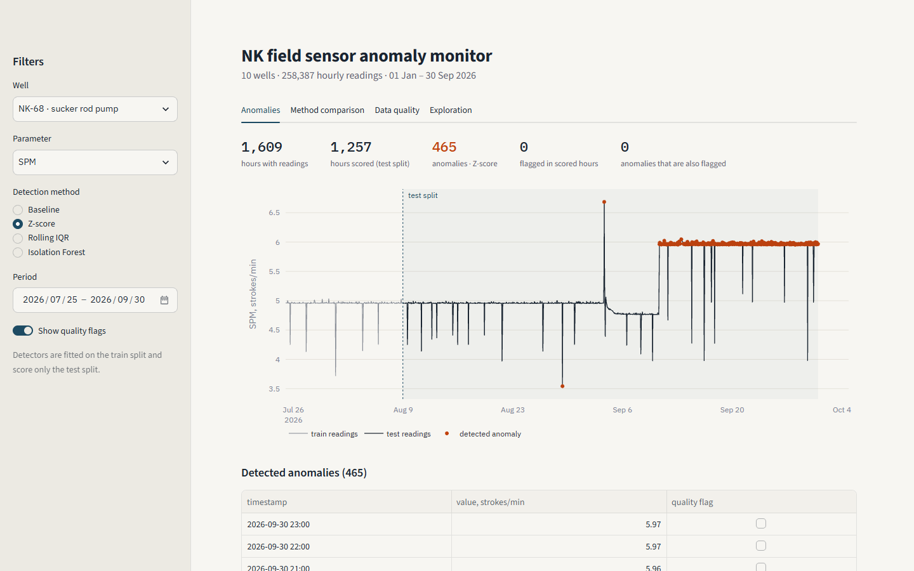
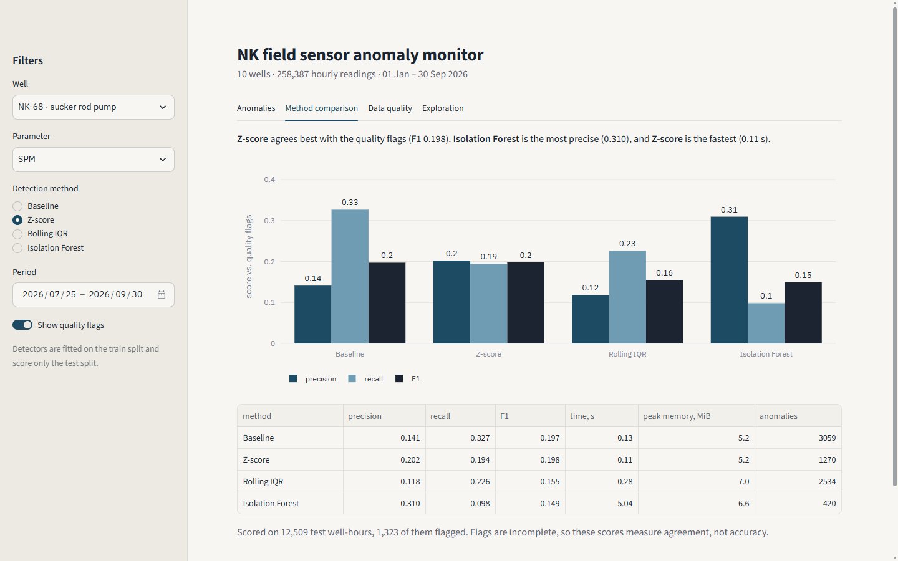
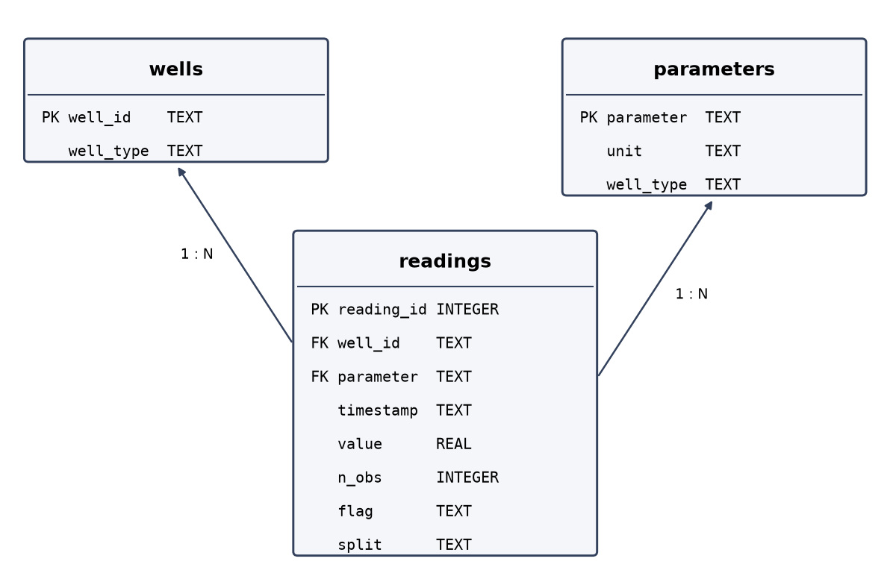

# Oil Well Sensor Anomaly Detection

Final project for *Programming for Data Analysis and Database* (Applied AI, AAI-2604M), topic 22.

Detects anomalous hourly sensor readings of 10 oil wells and compares three detectors against a baseline:

| Method | Idea |
| --- | --- |
| Baseline | Fixed percentile thresholds learned on train |
| Z-score | Distance from the train mean in standard deviations |
| Rolling IQR | Tukey fences over the preceding 48 hours |
| Isolation Forest | Tree-based isolation of multivariate outliers per well |

Quality flags from the dataset are used as a partial reference for precision / recall.



## Dataset

[NK Oil Well Sensor Monitoring v2](https://huggingface.co/datasets/Arailym-tleubayeva/NK-Oil-Well-Sensor-Monitoring-v2) —
258,387 hourly rows (long format), 10 wells (3 fountain, 7 sucker-rod pump), Jan–Sep 2026,
chronological train/test split (206,706 / 51,681 rows). Data is downloaded on first run into `data/`
and is not stored in the repository.

Known data issues handled by the project: `dynamometer_area` scale shift in May 2026,
NK-7 regime change from June 2026, multi-day collection gaps, overflow values in rod weights.

## Setup

Python 3.10+.

```bash
git clone https://github.com/yedilmyrzabek-wq/ProgrammingAI.git
cd ProgrammingAI
pip install -r requirements.txt
python main.py          # console menu, start with option 1
streamlit run app.py    # dashboard at http://localhost:8501
```

Option 1 downloads the CSV files (~25 MB), builds `data/long.parquet`, `data/wide.parquet` and `data/wells.db`.
The dashboard builds them automatically if they are missing.

## Console menu

| Option | Action |
| --- | --- |
| 1 | Prepare datasets and SQLite |
| 2 | Audit data quality |
| 3 | Compare anomaly detectors |
| 4 | Run a saved SQL query |
| 5 | Explore sensor data and generate figures |
| 6 | Inspect detected anomalies |
| 0 | Exit |

## Dashboard

| Tab | Content |
| --- | --- |
| Anomalies | Well, parameter, period and method filters; series with detected anomalies and quality flags |
| Method comparison | Precision, recall, F1, runtime and memory of all four methods |
| Data quality | Missing hours, longest gaps, dynamometer area shift, NK-7 regime change, flag rates |
| Exploration | Descriptive statistics and EDA figures |



## Project structure

```text
ProgrammingAI/
├── main.py                 console menu
├── app.py                  Streamlit dashboard
├── .streamlit/config.toml  dashboard theme
├── requirements.txt
├── src/
│   ├── config.py           paths and constants
│   ├── utils.py            runtime and memory measurement, JSON
│   ├── data_loader.py      download, long→wide pivot, dtype optimization, Parquet
│   ├── database.py         SQLite schema, loading, saved queries, ER diagram
│   ├── quality.py          data quality audit
│   ├── eda.py              statistics and figures
│   ├── detectors.py        Baseline, Z-score, Rolling IQR, Isolation Forest
│   └── evaluation.py       method comparison and report
├── sql/
│   ├── schema.sql          tables wells, parameters, readings
│   └── queries.sql         11 named queries
├── docs/                   ER diagram, dashboard screenshots
└── reports/                comparison.csv / .json, figures/
```

## Database



`sql/queries.sql` holds 11 named queries: JOINs (`readings_per_well`, `parameter_stats_by_type`),
GROUP BY / HAVING (`flags_by_well`), CTEs with `LAG` for gap detection (`time_gaps`, `missing_hours_per_well`),
window functions (`flag_rate_ranking` with `RANK`, `rolling_pump_fillage` with a 24-hour moving average),
a subquery (`extreme_vs_well_mean`), and checks of known issues (`monthly_dynamometer_area`, `nk7_regime_change`).
All results are loaded into pandas with `database.run_query(name)`.

## Storage formats

| Format | Size, MB | Memory after read, MB |
| --- | --- | --- |
| CSV | 19.2 | 32.4 |
| Parquet (categorical dtypes, float32) | 1.65 | 4.9 |

## Results

Run `python main.py` and select **Compare anomaly detectors** to regenerate the
[comparison table](reports/comparison.csv) and [chart](reports/figures/comparison.png).
The menu also lets you prepare Parquet and SQLite, audit data quality, run
the saved SQL queries, and generate exploratory figures. Select **Inspect
detected anomalies** to choose a well and a detector and list test timestamps
that the detector marks as anomalous. Baseline, Z-score, and Rolling IQR also
prompt for a sensor.
The Isolation Forest view shows the quality flag for the entire well-hour.

The comparison uses the dataset's chronological split. The baseline uses each
well's 1st and 99th training percentiles, and Z-score uses a three-standard-deviation
threshold fitted on train. Rolling IQR uses the preceding 48 hours and requires
at least 12 observed values for the sensor. Its window excludes the current
reading and can use earlier test readings as they become available. Isolation
Forest fits separately for each well with 2% contamination and uses training
medians to fill missing sensor values.

All four methods were scored on 12,509 test well-hours, 1,323 of which had at least
one quality flag. The three per-sensor detectors count an hour as anomalous if
any sensor was marked anomalous. Isolation Forest scores the whole well-hour.
Z-score had the highest F1 (0.198), close to the baseline
(0.197). Isolation Forest had the highest precision (0.310) and the lowest recall
(0.098). These scores measure agreement with incomplete quality flags. Runtime
includes fitting and prediction with `tracemalloc` enabled. Peak traced MiB
reports the peak allocations tracked during that run.

In the quality audit, the median of unflagged dynamometer area readings rose
14–20 times from April to May across the seven pump wells. At NK-7, median SPM
fell from 4.16 to 1.40 after the June cutoff, while the median rod weights rose.

## Team

| Member | Contribution |
| --- | --- |
| Yedil Myrzabek | Data loading and Parquet, SQLite and SQL queries, ER diagram, EDA, Streamlit dashboard |
| Shyntassov Abdurahmans | Resource measurement, anomaly detectors, method comparison, data quality audit, console menu |
